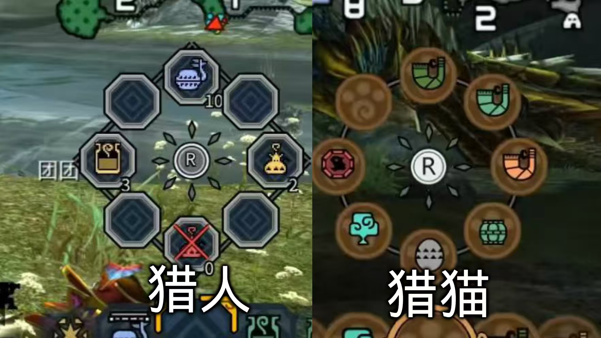

# MHGU Shortcut Wheel

[简体中文](./README.md) | **English**

An eight-direction shortcut wheel for *Monster Hunter Generations Ultimate*. Hunters can assign items to the wheel and switch between four presets. In Prowler mode, the wheel shows your Support Moves in equipped order. A red × marks a move that needs more Support Gauge than you have.

The Hunter wheel shows items (left). The Prowler wheel shows equipped Support Moves (right). [Watch the shortcut wheel video on Bilibili](https://www.bilibili.com/video/BV1vEyWzWEb6/)

## Download v0.51

Open **Releases → v0.51 → Assets** and download the file for your platform.

| Platform | Download | Installation |
| --- | --- | --- |
| PC port | `MHGU-Quick-Wheel-v0.51-PC.zip` | Extract the archive, put `GU-CraftWheel` in the game's `mods` folder, enable it and restart. For mouse and keyboard, see the included instructions for the cursor-centering module. |
| Eden emulator | `MHGU-Quick-Wheel-v0.51-Eden.zip` | Put `GU-CraftWheel` in the game's mod directory and enable it. The required dependencies are included. |
| Nintendo Switch | `MHGU-Quick-Wheel-v0.51-Switch.zip` | Merge the included `atmosphere` folder into the root of your SD card. The required dependencies are included. |
| MHGU CLOUD for Android | `MHGU-CLOUD-v0.51-Android.apk` | Install the APK and launch CLOUD. It installs the wheel and fonts in the current game directory. |
| Standalone Android mod | `MHGU-Quick-Wheel-v0.51-Android.zip` | Put `GU-CraftWheel` in the `mods` folder of a compatible port, enable it and restart. For full touch controls, use the CLOUD APK above. |

To get all platforms, dependencies and source code in one archive, download `MHGU-Quick-Wheel-v0.51-All.zip`. The wheel source and the CLOUD host source are also available separately. File checksums are in `SHA256SUMS.txt` on the same release page.

## Using the wheel

1. Open the **+ menu**, go to **page 3** and select **Configure Shortcut Wheel**. Assign items to the eight directions, then save your preset.
2. During a quest, hold **L** on a controller or **Q** on a keyboard to open the wheel. Aim with the right stick or mouse.
3. With **Quick switching** enabled, hold the wheel button and press the preset switch button once to cycle to the next saved preset. For example, if the wheel is bound to **A** and the preset switch to **B**, hold **A** and tap **B**. The settings screen shows the icons for your current bindings.
4. In Android CLOUD touch mode, hold the item pouch, slide toward the desired slot and lift your finger to close the wheel. On the settings screen, tap a preset on the left to switch to it.

## Source and builds

Platform source code is in `port/`, `eden/`, `switch/` and `android/`. Shared textures and fonts are in `assets/`. The PC cursor-centering module is in `cursor/`. The [build instructions (Chinese)](./构建说明.txt) cover the tools, build commands for each platform and how to run the tests. To rebuild the Android APK, download `MHGU-CLOUD-v0.51-Host-Source.zip` from the release and follow the instructions inside.

Licenses and sources for third-party components and fonts are in [licenses](./licenses/) and in the respective upstream source directories. The item pouch and some icons are extracted from the game.

## Feedback

Open **Issues → New issue**. Include your platform, game or port version, wheel version, input method (controller, mouse and keyboard, or touch) and the first step where the problem occurs. You can redact personal file paths and account details before attaching screenshots or log excerpts.
