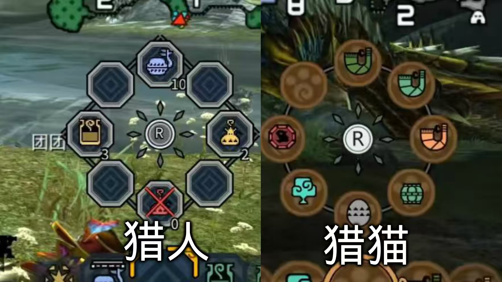

# MHGU 快捷轮盘

**简体中文** | [English](./README.en.md)

为《怪物猎人Generations Ultimate》增加快捷轮盘。猎人可以登记道具、切换四组预设；猎猫轮盘会按装备顺序显示支援行动，支援槽不足时显示红叉。

左边是猎人的道具轮盘，右边是猎猫的支援行动轮盘。 [在哔哩哔哩观看快捷轮盘视频介绍](https://www.bilibili.com/video/BV1vEyWzWEb6/)

## 下载 v0.51

打开仓库右侧的 **Releases**，进入 **v0.51**，展开页面底部的 **Assets**。玩哪个平台，就下载对应的文件。

| 平台 | 下载文件 | 怎样安装 |
| --- | --- | --- |
| PC 移植版 | `MHGU-Quick-Wheel-v0.51-PC.zip` | 解压后将 `GU-CraftWheel` 放入游戏的 `mods`，启用后重启。键鼠指针归中模块的安装见包内说明。 |
| Eden 模拟器 | `MHGU-Quick-Wheel-v0.51-Eden.zip` | 将 `GU-CraftWheel` 放入该游戏的 MOD 目录并启用。包内含前置。 |
| Switch | `MHGU-Quick-Wheel-v0.51-Switch.zip` | 将包内的 `atmosphere` 合并到 SD 卡根目录。包内含前置。 |
| 安卓 MHGU CLOUD 整合版 | `MHGU-CLOUD-v0.51-Android.apk` | 安装 APK，启动 CLOUD。轮盘和字体会部署到当前游戏目录。 |
| 安卓独立 MOD | `MHGU-Quick-Wheel-v0.51-Android.zip` | 将 `GU-CraftWheel` 放入兼容移植版的 `mods` 目录，启用后重启。需要完整触屏操作时，推荐上面的 CLOUD 整合版。 |

需要一次取得所有平台、前置和源码，可下载 `MHGU-Quick-Wheel-v0.51-All.zip`。轮盘源码和 CLOUD 宿主源码也可单独下载。附件的 SHA-256 见同页的 `SHA256SUMS.txt`。

## 游戏里怎么用

1. 打开游戏的 **＋ 菜单 → 第三页 → 配置快捷轮盘**。在八个方向登记道具，保存到预设。
2. 任务中长按呼出键展开轮盘，手柄默认 **L**，PC 键鼠默认 **Q**。用右摇杆或鼠标选择方向。
3. 开启「快捷切换」后，按住当前呼出键，再按一次预设切换键，跳到下一组已保存的预设。例如呼出键为 A、切换键为 B，组合就是 **A+B**。设置里的图标也随绑定更新。
4. 安卓 CLOUD 的触屏模式中，长按道具袋、向目标方向滑动，松手收起轮盘。在设置界面轻点左侧预设即可切换。

## 源码和构建

四个平台的源码分别位于 `port/`、`eden/`、`switch/`、`android/`，共用贴图和字体位于 `assets/`。PC 指针归中模块位于 `cursor/`。构建工具、四个平台的命令和测试入口见[构建说明](构建说明.txt)。重建安卓 APK 使用 Release 中的 `MHGU-CLOUD-v0.51-Host-Source.zip` 及其中的构建说明。

第三方组件和字体的许可与来源见 [licenses](licenses/) 及各上游源码目录。游戏提取素材包括道具袋与部分图标。

## 反馈

在仓库的 **Issues → New issue** 描述问题。请写明平台、游戏或移植版版本、轮盘版本、使用手柄／键鼠／触屏，以及从哪一步开始出现异常。附截图或相关日志片段前，可先遮去个人路径和账号信息。
